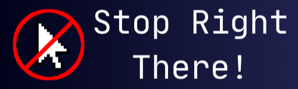
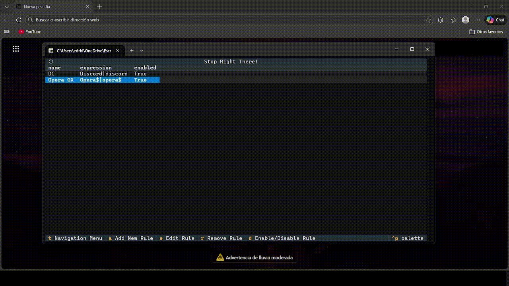

# Stop Right There

## About

Stop Right There is a Desktop App for Windows to stop distractions based in your active window title and regular expressions (regex).

## Table of Contents

- [About](#about)
- [Table of Contents](#table-of-contents)
- [Main Features](#main-features)
- [Architecture](#architecture)
- [Installation](#installation)
- [Usage](#usage)
- [Building from source](#building-from-source)
- [Contributing](#contributing)
- [License](#license)
- [Resources](#resources)

## Main Features

- A terminal user interface (TUI) made with Textual framework
- Blacklist windows by writing a regular expression to detect the title of your active window
- Privacy, I do not receive any user data

## Architecture

- UI: Python [Textual Framework](https://github.com/textualize/textual/) v6.6.0
- Data: All data is stored in the app files
- Window Manager: I use windll from cytypes and win32gui to read the window titles

## Installation

Install the zip and run the StopRightThereApp.exe

## Usage

[Read the usage document](USAGE.md)

## Building from source

[Read the building from source document](BUILDING_FROM_SOURCE.md)

## Contributing

Contribution guidelines are still being written.  
In the meantime, feel free to open issues or pull requests if you have improvements or fixes.

## License

This project is licensed under the MIT License.  
You are free to use, modify, and fork this project in accordance with the license.

## Resources

- [Zeeshan Ahmad - Learn Regex The Easy Way](https://github.com/ziishaned/learn-regex): A github repository that explains what is a regular expression and how to build them, it has translations to other languages.
- [Grant Skinner - RegExr](https://regexr.com/): A website that helps to build and test regular expressions.
- [Python 're' library documentation](https://docs.python.org/3/library/re.html): Documentation of the python regular expression library, for developers.
- [Textual Framework](https://github.com/textualize/textual/): Textual framework documentation
- [Pyinstaller documentation](https://pyinstaller.org/en/stable/)
