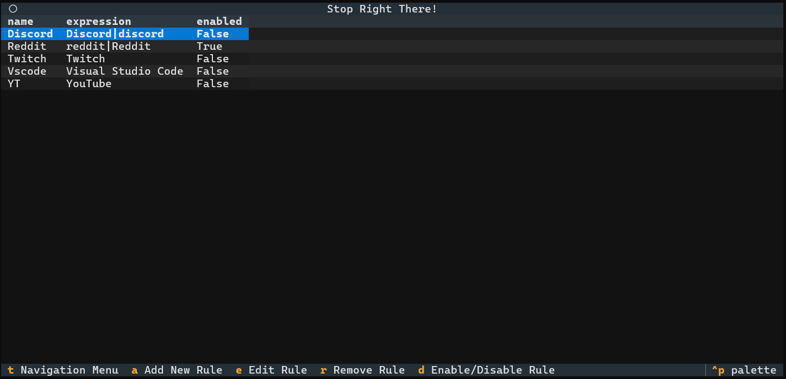
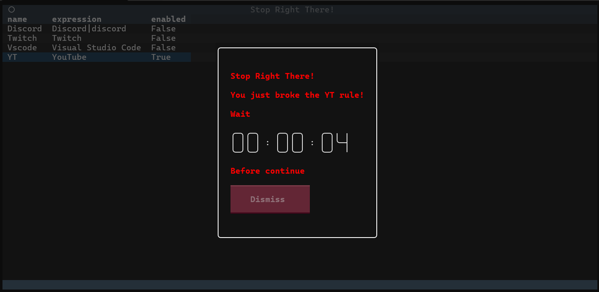
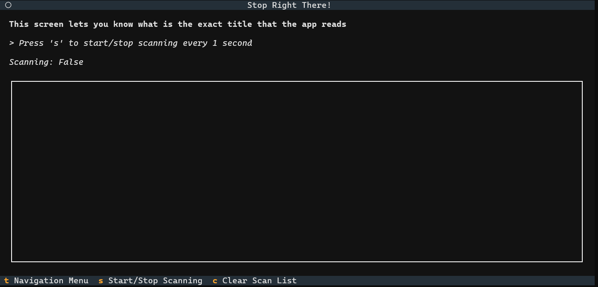
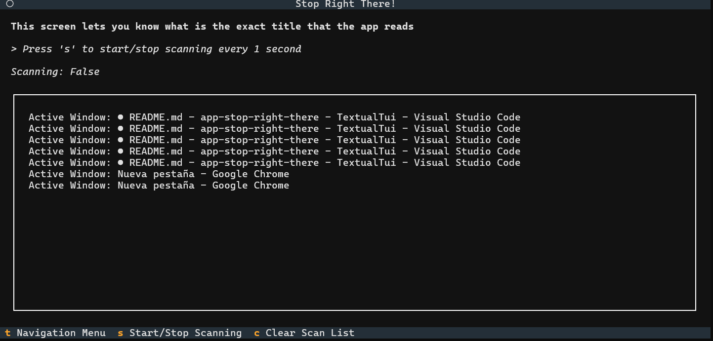
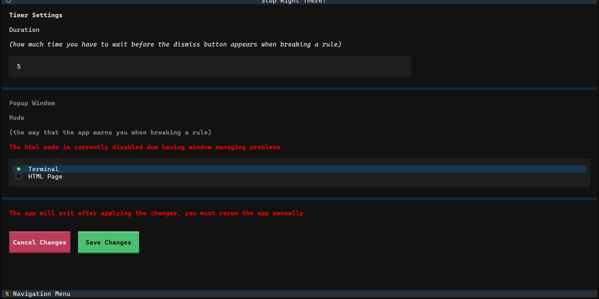

# Usage

## Main Screen

The main screens shows your blacklist, a list of rules.

A rule is just a item that determines which windows have to be blacklisted. Breaking a rule means that you accessed to a blacklisted window.

Each rule has the following attributes:

- **Name:** It must be unique, it helps you to know which rule is applied to your active window
- **Expression:** The regular expression of the rule, it will trigger the rule if it matches with active window title
- **Enabled:** Applies the rule if true, if not it will be ignored even if the expression matches with the active window title

Your **active window title** is the title of the window that is currently focused, the background windows doesn't count.

## Rule management

You can manage all rules from the **Main Screen**

### Adding and editing rules

- To add a rule press the binding `a`, this will show a new screen where you will have to fill the fields of the rule.
- To edit a rule, select one and press the binding `e`, you can't edit the title
- You can disable and enable a rule easily by selecting it and pressing `d`, this will switch the state of the rule.

### Removing rules

- To delete the rule, select one and press the binding `r`, this will popup a confirmation window:
  - Press `esc` to cancel
  - Press `r` again to confirm the deletion

## About Regular Expressions

> For users that doesn't know what Regular Expressions (RegEx) are I recommend these [resources](README.md#resources)

The function that reads regular expressions uses `re.search()`. This method scans through the title looking for a match to the pattern.

For example, having a rule with the expression: **YouTube** will have the following effects on these titles:

- **Chrome**: It won't match
- **YouTube**: It will match
- **YouTube - Home**: It will match
- **Chrome - YouTube**: It will match
- **Chrome - youtube**: It won't match because of the lower case `y` and `t`

## Warning Screen

When you break any of your enabled rules it will show up the following screen:

This screens displays the name of the rule that has been broken and a timer. The only purpose of the timer is to prevent disabling instantly the broken rule, its duration can be modified in the [Configuration Screen](#configuration-screen).

> The app will show the warning screen above your other screens until you exit the blacklisted window, so you cant just ignore it.

## Window Title Display Screen

This screen serves as a tool to build rule expressions. Pressing the `s` binding will start reading your active window title and it will display the text in the interface.

To stop the scanning just press `s` again.

## Configuration Screen

This screen lets you to change your preferences of the app.

- Timer Settings
  - Duration: The how much you have to wait to dismiss the Warning screen, in seconds.

- Popup Window Settings:
  - Mode: How the app prevents you to accessing blacklisted windows.

> Popup Window: This is configuration is currently disabled and the default value is `Terminal`

## Closing the App

You can close the app by pressing `ctrl+q` or just close the terminal window.
